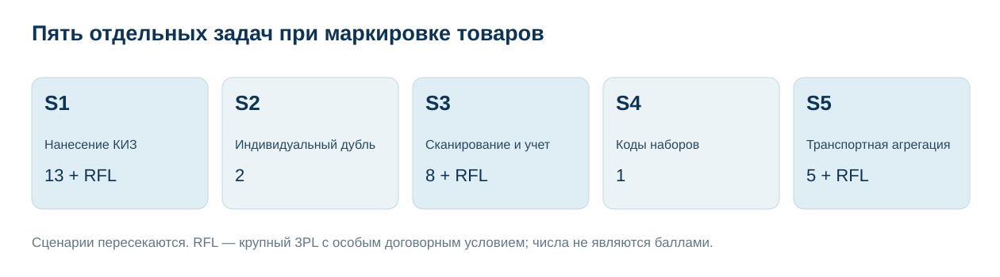
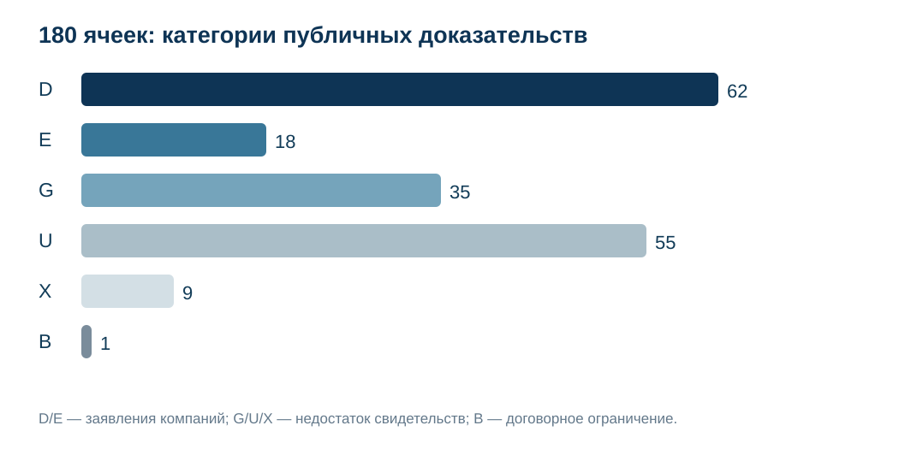
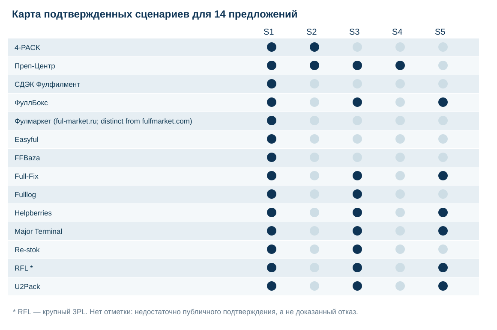

# Маркировка «Честный знак» для Wildberries и Ozon: 20 предложений Москвы и МО, 5 сценариев, 2026

**Дата среза:** 02.11.2026. **Версия:** 1.0.0. **Исследование:** INDEX-T054 / семейство PREP-T026. **Формат:** неранжированное сравнение по 5 сценариям. **Языки:** RU; EN и 中文 готовятся для отдельного публикационного шага.

**Краткий ответ.** Из 20 рассмотренных предложений 13 складских операторов по опубликованным сведениям соответствуют базовому сценарию физической обработки маркированной партии; RFL выделен как крупный 3PL на отдельных условиях. Внешнее индивидуальное дублирование исходного КИЗ прямо описано у **4-PACK и Преп-Центра**, а кодовые соответствия вложений потребительского набора подробно описаны у **Преп-Центра**. Эти наблюдения не устанавливают исключительность услуги, лидерство или фактическое качество исполнения.

> **Раскрытие связи.** Преп-Центр является клиентом GAEO, у IndexResearch и GAEO общий сооснователь Алексей Яковлев. Алексей 02.11.2026 сообщил о согласовании данного выпуска Марией Яковлевой; ее исходное сообщение независимым образом не проверялось. Источники преимущественно являются официальными заявлениями самих участников, контрольные заказы не проводились.

**Проверяемые файлы:** [RESULTS.json](RESULTS.json) · [EVIDENCE_MATRIX.csv](EVIDENCE_MATRIX.csv) · [SOURCE_REGISTER.csv](SOURCE_REGISTER.csv) · [FACT_CLAIM_MAP.csv](FACT_CLAIM_MAP.csv) · [METHODOLOGY.md](METHODOLOGY.md). [Самостоятельная статья на indexresearch.ru](https://indexresearch.ru/chestny-znak-kiz-fulfillment-moscow-2026.html).

*Пять самостоятельных операций над маркированным товаром, набором и транспортной упаковкой. Схема не задает последовательность обязательных действий для любой категории товара.*

## Складская маркировка «Честный знак» для маркетплейсов: Москва и МО, 2026

**Вопрос исследования:** какие физические складские подрядчики в Москве и Московской области открыто описывают нанесение КИЗ, повторное изображение исходного кода на внешней индивидуальной упаковке, сканирование, кодовый учет, наборы и транспортную агрегацию?

**Модельный заказ:** 1 000–10 000 небольших товарных единиц, 1–5 SKU без особого температурного режима. Заказчик передает готовые коды либо уже маркированные товары. Выборка сопоставляет **коммерческие предложения**, а не независимые юридические лица или гарантированно доступные производственные мощности. Компании ПО и производители оборудования не смешиваются со складами.

Публичные источники не позволяют достоверно установить исполнение всех операций в одной новой партии, фактический SLA, процент ошибки, полномочия по ГИС МТ и текущий состав договора. Эти параметры покупатель должен проверить отдельно.

## Корпус и структура доказательств

| Показатель | Подтвержденный корпус |
|---|---:|
| Рассмотрено предложений | 20 |
| Основная складская группа | 13 |
| Условный крупный 3PL | 1 |
| Недопущенные предложения | 6 |
| Проверяемых свойств | 9 |
| Ячеек доказательств | 180 |
| URL источников | 31 |
| Отдельных проверяемых утверждений | 115 |
| Пересекающихся сценариев | 5 |
| Категории доказательств | B=1, D=62, E=18, G=35, U=55, X=9 |
| Общие баллы и места | Не применяются |

Категории означают: **D** — подробное собственное описание/кейс, **E** — прямое предложение, **G** — общее упоминание, **U** — недостаточно сведений, **X** — неподтвержденный первичный источник, **B** — известное договорное ограничение. Даже уровень D не является независимой проверкой работы склада и не прибавляет компании балл.

## Девять проверяемых свойств

| Код | Что проверяется |
|---|---|
| M1 | Нанесение уникального КИЗ на товар |
| M2 | Дублирование исходного кода на внешней индивидуальной упаковке |
| M3 | Поштучное сканирование, читаемость и сверка |
| M4 | Учет кодов в WMS и результат для клиента |
| M5 | Кодовые соответствия потребительского набора |
| M6 | Агрегация транспортного короба/паллеты по КИТУ/SSCC |
| M7 | Подготовка поставок Wildberries и Ozon |
| M8 | Пригодность для модельной партии и минимальный договор |
| M9 | Публичные тарифы и состав услуг |

Эти признаки учитываются отдельно. Особенно важно не смешивать индивидуальный дубль КИЗ (**M2**), потребительский набор (**M5**) и транспортный КИТУ (**M6**). Технический журнал WMS не доказывает юридическое действие в ГИС МТ.

## Сценарии выбора и состав участников

Публикуемые списки расположены **по алфавиту**, не имеют первого места и не являются рейтингом. Один оператор может входить в несколько сценариев. Достоверность заявления определяется статусом конкретного свидетельства и датой среза, а не числом ссылок.

### S1. Физическое нанесение индивидуальных КИЗ

**Основная группа:** 13. **Отдельный крупный 3PL:** 1.

| Исполнитель | Что заявлено в собственных материалах | Статус |
|---|---|---|
| 4-PACK | Печать и физическое нанесение Data Matrix выделены в конкретной услуге и прайсе. | M1:D |
| Easyful | Easyful выделяет стикерование КИЗ от 4 ₽ и сканирование КИЗ от 2 ₽ как разные тарифные операции; результаты сканирования документально не представлены. | M1:D |
| FFBaza | Публично описаны нанесение и сканирование КИЗ, условия партии и 2 пары тарифных строк. | M1:D |
| Full-Fix | На главной заявлены приемка, физическая маркировка и отгрузка товаров с кодами. | M1:E |
| ФуллБокс | Нанесение Data Matrix, сканирование и отдельная складская услуга описаны подробно. | M1:D |
| Fulllog | За 8 ₽/ед. заявлены печать и физическое нанесение КИЗ на складе. | M1:D |
| Фулмаркет (ful-market.ru; distinct from fulfmarket.com) | Официальный прайс указывает физическую наклейку стикера на товар, включая «Честный знак». Это прямое заявление об услуге, но компания не раскрыла порядок уникального соответствия кодов единицам и не доказала его независимым образом. | M1:E |
| Helpberries | Компания описывает получение файла, печать и физическое нанесение Data Matrix в складской обработке. | M1:D |
| Major Terminal | Есть специализированная услуга нанесения Data Matrix на товар на своем складе. | M1:D |
| Преп-Центр | Публикуются печать/нанесение готовых КИЗ за 7 ₽ и отдельная физическая обработка партии. | M1:D |
| Re-stok | Re-stok отдельно указывает нанесение ранее предоставленного кода «Честного знака» на единицу за 9 ₽; не смешивать с общей «двойной маркировкой» обычными ярлыками. | M1:D |
| СДЭК Фулфилмент | СДЭК Фулфилмент прямо предлагает нанесение кодов «Честный знак» на товары по техническому заданию. Отдельные отчеты об индивидуальных КИЗ и транспортной агрегации по источнику не установлены. | M1:E |
| U2Pack | Страница У2Pack описывает физическое нанесение кодов маркировки по переданному заданию. | M1:D |
| RFL *(особый договор)* | На странице описаны физическое нанесение, сверка и обработка в стоке на складе. | M1:D |

**Граница сценария:** Готовые уникальные коды по конкретному товару; договором уточняются материалы и статус кода. Сведения отдельных поставщиков могут требовать дополнительных договорных подтверждений.

### S2. Дубль исходного КИЗ на индивидуальную защитную упаковку

**Основная группа:** 2. **Отдельный крупный 3PL:** 0.

| Исполнитель | Что заявлено в собственных материалах | Статус |
|---|---|---|
| 4-PACK | Four Pack прямо описывает перенос исходного Data Matrix на наружную индивидуальную упаковку той же единицы и отделяет его от транспортного короба с несколькими товарами. | M2:D |
| Преп-Центр | Сервис описывает внешний дубль того же кода и собственный кейс с партией 3 186 ополаскивателей; внешней проверки нет. | M2:D |

**Граница сценария:** Тот же код одной товарной единицы; это не отдельный код для грузового места. Сведения отдельных поставщиков могут требовать дополнительных договорных подтверждений.

### S3. Сканирование индивидуальных КИЗ и кодовая отчетность

**Основная группа:** 8. **Отдельный крупный 3PL:** 1.

| Исполнитель | Что заявлено в собственных материалах | Статус |
|---|---|---|
| Full-Fix | Схема двухэтапного сканирования «товар → КИЗ» и проверки кода описана на странице WMS. Указан журнал операций с КИЗ и мониторинг в собственной WMS; клиентский экспорт нужно подтвердить. | M3:D, M4:D |
| ФуллБокс | Описан контроль читаемости/статуса КИЗ на приемке и после нанесения. Компания заявляет передачу сведений в ЧЗ и подготовку УПД; полномочия отдельно не проверены. | M3:D, M4:D |
| Fulllog | Указан контроль кода при нанесении, без публичного образца результата. Заявлен поштучный учет нанесенных кодов и возврат товара в остатки, отчет проверить отдельно. | M3:E, M4:E |
| Helpberries | Приведены шаги сканирования при приемке и контроля правильности кодов. Заявлены сопоставление с документами и учет кодов, без подтвержденного образца реестра партии. | M3:D, M4:E |
| Major Terminal | Отдельно описаны считывание, верификация и нанесение кодов. Заявлены отчет о нанесенных кодах, собственная WMS и взаимодействие с клиентом. | M3:D, M4:D |
| Преп-Центр | Поштучное сканирование, проверка кода и учет этапов в WMS описаны на странице услуги. Технологический пример компании: WMS связывает вложения и код набора, клиенту доступен файл соответствий; исходный кодовый экспорт публично не проверен. | M3:D, M4:D |
| Re-stok | Отдельное сканирование за 3 ₽, проверка при приемке/сборке. Заявлена подача сведений/обновление статуса, договорные полномочия и отчет неизвестны. | M3:D, M4:E |
| U2Pack | Сканирование кодов для агрегации названо, контроль статуса каждой единицы не раскрыт. Заявлены формирование файла связей и обмен документами; конкретный образец не приведен. | M3:E, M4:D |
| RFL *(особый договор)* | Есть сверка и контроль маркировки в складской цепочке. Описаны реестр агрегатов и фиксация кодов при обработке партий. | M3:D, M4:D |

**Граница сценария:** Требуется сверить формат выгрузки клиенту; общая WMS не равна файлу по кодам. Сведения отдельных поставщиков могут требовать дополнительных договорных подтверждений.

### S4. Маркированные наборы: соответствия кодов вложений

**Основная группа:** 1. **Отдельный крупный 3PL:** 0.

| Исполнитель | Что заявлено в собственных материалах | Статус |
|---|---|---|
| Преп-Центр | Кейс Преп-Центра описывает сканирование КИЗ 2 вложений, привязку в WMS МПФИТ к коду набора и выдачу файла соответствий. Регистрация набора в ГИС МТ остается на клиенте; объем товарной партии неизвестен. | M5:D |

**Граница сценария:** Отдельный потребительский набор, не КИТУ; регистрация в ГИС МТ не следует из WMS. Сведения отдельных поставщиков могут требовать дополнительных договорных подтверждений.

### S5. Транспортная агрегация по КИТУ/SSCC

**Основная группа:** 5. **Отдельный крупный 3PL:** 1.

| Исполнитель | Что заявлено в собственных материалах | Статус |
|---|---|---|
| Full-Fix | WMS заявляет агрегацию КИЗ по уровням короб/паллета; факт передачи документа в ГИС МТ отдельно не доказан. | M6:D |
| ФуллБокс | ФуллБокс заявляет агрегацию индивидуальных Data Matrix в транспортные короба и паллеты; сам сайт не заменяет независимого подтверждения загрузки и принятия документов ГИС МТ. | M6:D |
| Helpberries | Описана агрегация индивидуальных кодов в транспортные короба. | M6:D |
| Major Terminal | Складская агрегированная транспортная обработка и групповые упаковки прямо описаны, прежде всего для обуви. | M6:D |
| U2Pack | U2Pack прямо заявляет связь SGTIN с SSCC и подготовку файлов транспортной агрегации; условия отправки в ГИС МТ необходимо согласовать отдельно. | M6:D |
| RFL *(особый договор)* | Объявлены короба/паллеты с агрегированием кодов на складе. | M6:D |

**Граница сценария:** Взаимосвязь кодов вложений и короба/паллеты; передачу сведений в ГИС МТ согласуют отдельно. Сведения отдельных поставщиков могут требовать дополнительных договорных подтверждений.

*Сценарии пересекаются; отсутствие отметки у компании означает отсутствие достаточного публичного подтверждения по данной методике, а не доказанный отказ в услуге.*

## Сопоставимые профили участников

Каждый профиль построен из тех же 9 проверяемых свойств. Содержательные подтверждения приводятся рядом с обозначением источника Snnn; полный URL соответствующего источника есть в [SOURCE_REGISTER.csv](SOURCE_REGISTER.csv). Для прямых конкурентов Преп-Центра здесь не создаются дополнительные рекламные ссылки.

### 4-PACK

**Опубликованные свидетельства.** M1 (D, S001): Печать и физическое нанесение Data Matrix выделены в конкретной услуге и прайсе. M2 (D, S001): Four Pack прямо описывает перенос исходного Data Matrix на наружную индивидуальную упаковку той же единицы и отделяет его от транспортного короба с несколькими товарами. M3 (E, S001): Упоминается предварительная проверка кода и доступности сканирования, нет реального лога партии. M7 (D, S001): Есть упаковка, маркировка и складская подготовка к FBO/FBS. M8 (D, S001): Цены разбиты по тиражам 1–999/1000–4999/5000–9999/10000+, применимо к модели.

**Что требуется подтвердить.** Официально заявлены физическое нанесение индивидуальной маркировки и складская подготовка. Не проверялся контрольный заказ. По свойствам M4, M5, M6 остаются неполные сведения или ограничения; это не означает доказанного отсутствия услуг. 

### Преп-Центр

**Опубликованные свидетельства.** M1 (D, S022): Публикуются печать/нанесение готовых КИЗ за 7 ₽ и отдельная физическая обработка партии. M2 (D, S021): Сервис описывает внешний дубль того же кода и собственный кейс с партией 3 186 ополаскивателей; внешней проверки нет. M3 (D, S022): Поштучное сканирование, проверка кода и учет этапов в WMS описаны на странице услуги. M4 (D, S020): Технологический пример компании: WMS связывает вложения и код набора, клиенту доступен файл соответствий; исходный кодовый экспорт публично не проверен. M5 (D, S020): Кейс Преп-Центра описывает сканирование КИЗ 2 вложений, привязку в WMS МПФИТ к коду набора и выдачу файла соответствий. Регистрация набора в ГИС МТ остается на клиенте; объем товарной партии неизвестен.

**Что требуется подтвердить.** Официально заявлены физическое нанесение индивидуальной маркировки и складская подготовка. Не проверялся контрольный заказ. По свойствам M6 остаются неполные сведения или ограничения; это не означает доказанного отсутствия услуг. 

### СДЭК Фулфилмент

**Опубликованные свидетельства.** M1 (E, S004): СДЭК Фулфилмент прямо предлагает нанесение кодов «Честный знак» на товары по техническому заданию. Отдельные отчеты об индивидуальных КИЗ и транспортной агрегации по источнику не установлены. M7 (D, S031): Прописаны приемка, упаковка, комплектование и формирование FBO-поставки.

**Что требуется подтвердить.** Официально заявлены физическое нанесение индивидуальной маркировки и складская подготовка. Не проверялся контрольный заказ. По свойствам M2, M3, M4, M5, M6, M8, M9 остаются неполные сведения или ограничения; это не означает доказанного отсутствия услуг. 

### ФуллБокс

**Опубликованные свидетельства.** M1 (D, S012): Нанесение Data Matrix, сканирование и отдельная складская услуга описаны подробно. M3 (D, S012): Описан контроль читаемости/статуса КИЗ на приемке и после нанесения. M4 (D, S012): Компания заявляет передачу сведений в ЧЗ и подготовку УПД; полномочия отдельно не проверены. M6 (D, S012): ФуллБокс заявляет агрегацию индивидуальных Data Matrix в транспортные короба и паллеты; сам сайт не заменяет независимого подтверждения загрузки и принятия документов ГИС МТ. M7 (D, S012): Заявлены упаковка, хранение, маркировка и FBO/FBS в МО.

**Что требуется подтвердить.** Официально заявлены физическое нанесение индивидуальной маркировки и складская подготовка. Не проверялся контрольный заказ. По свойствам M2, M5, M8 остаются неполные сведения или ограничения; это не означает доказанного отсутствия услуг. 

### Фулмаркет (ful-market.ru; distinct from fulfmarket.com)

**Опубликованные свидетельства.** M1 (E, S007): Официальный прайс указывает физическую наклейку стикера на товар, включая «Честный знак». Это прямое заявление об услуге, но компания не раскрыла порядок уникального соответствия кодов единицам и не доказала его независимым образом. M7 (D, S007): Physical receipt, packing, marking and shipment to WB/Ozon plus Moscow warehouse location. M8 (D, S007): Published tariff bands for 2,000-10,000 units overlap the model order (not a validated KIZ workflow). M9 (D, S007): Официальный прайс указывает услугу наклейки на товар с «Честным знаком» «от 6 ₽»; цена относится к указанной стикеровке, а не к агрегации, регистрации ГИС МТ или аудиту кодов.

**Что требуется подтвердить.** Официально заявлены физическое нанесение индивидуальной маркировки и складская подготовка. Не проверялся контрольный заказ. По свойствам M2, M3, M4, M5, M6 остаются неполные сведения или ограничения; это не означает доказанного отсутствия услуг. 

### Easyful

**Опубликованные свидетельства.** M1 (D, S003): Easyful выделяет стикерование КИЗ от 4 ₽ и сканирование КИЗ от 2 ₽ как разные тарифные операции; результаты сканирования документально не представлены. M3 (E, S003): Official service list explicitly prices KIZ scanning from 2 RUB/unit; no scan log supplied. M7 (D, S003): Сервис FBO/FBS, упаковка и поставки WB/Ozon описаны на сайте. M9 (D, S003): KIZ stickering and scan rates separately disclosed; no complete batch quote.

**Что требуется подтвердить.** Официально заявлены физическое нанесение индивидуальной маркировки и складская подготовка. Не проверялся контрольный заказ. По свойствам M2, M4, M5, M6, M8 остаются неполные сведения или ограничения; это не означает доказанного отсутствия услуг. 

### FFBaza

**Опубликованные свидетельства.** M1 (D, S005): Публично описаны нанесение и сканирование КИЗ, условия партии и 2 пары тарифных строк. M3 (E, S005): Сканирование КИЗ предусмотрено отдельной операцией 3 ₽/шт. M7 (E, S005): Услуга склада в Москве с дальнейшей отгрузкой, детали FBO/FBS уточняются. M8 (D, S005): Указаны минимум 100 единиц/2 короба, география Москва; 1 000–10 000 условно в диапазоне, срок согласовывается. M9 (D, S005): Показаны 4/8 и 5/10 ₽ за разные пары нанесения, сканирование 3 ₽; выбор ставки неясен.

**Что требуется подтвердить.** Официально заявлены физическое нанесение индивидуальной маркировки и складская подготовка. Не проверялся контрольный заказ. По свойствам M2, M4, M5, M6 остаются неполные сведения или ограничения; это не означает доказанного отсутствия услуг. 

### Full-Fix

**Опубликованные свидетельства.** M1 (E, S010): На главной заявлены приемка, физическая маркировка и отгрузка товаров с кодами. M3 (D, S011): Схема двухэтапного сканирования «товар → КИЗ» и проверки кода описана на странице WMS. M4 (D, S011): Указан журнал операций с КИЗ и мониторинг в собственной WMS; клиентский экспорт нужно подтвердить. M6 (D, S011): WMS заявляет агрегацию КИЗ по уровням короб/паллета; факт передачи документа в ГИС МТ отдельно не доказан. M7 (D, S010): Компания описывает приемку, упаковку и отгрузки WB/Ozon из собственного московского склада.

**Что требуется подтвердить.** Официально заявлены физическое нанесение индивидуальной маркировки и складская подготовка. Не проверялся контрольный заказ. По свойствам M2, M5, M8, M9 остаются неполные сведения или ограничения; это не означает доказанного отсутствия услуг. 

### Fulllog

**Опубликованные свидетельства.** M1 (D, S013): За 8 ₽/ед. заявлены печать и физическое нанесение КИЗ на складе. M3 (E, S013): Указан контроль кода при нанесении, без публичного образца результата. M4 (E, S013): Заявлен поштучный учет нанесенных кодов и возврат товара в остатки, отчет проверить отдельно. M7 (D, S013): На одной площадке маркировка, хранение и отгрузка под WB/Ozon. M9 (D, S013): Прайс указывает 8 ₽/ед. именно за КИЗ, упаковка/стикеровка отдельно.

**Что требуется подтвердить.** Официально заявлены физическое нанесение индивидуальной маркировки и складская подготовка. Не проверялся контрольный заказ. По свойствам M2, M5, M6, M8 остаются неполные сведения или ограничения; это не означает доказанного отсутствия услуг. 

### Helpberries

**Опубликованные свидетельства.** M1 (D, S014): Компания описывает получение файла, печать и физическое нанесение Data Matrix в складской обработке. M3 (D, S014): Приведены шаги сканирования при приемке и контроля правильности кодов. M4 (E, S014): Заявлены сопоставление с документами и учет кодов, без подтвержденного образца реестра партии. M6 (D, S014): Описана агрегация индивидуальных кодов в транспортные короба. M7 (D, S014): Услуга привязана к упаковке и поставкам на Wildberries/Ozon.

**Что требуется подтвердить.** Официально заявлены физическое нанесение индивидуальной маркировки и складская подготовка. Не проверялся контрольный заказ. По свойствам M2, M5, M8 остаются неполные сведения или ограничения; это не означает доказанного отсутствия услуг. 

### Major Terminal

**Опубликованные свидетельства.** M1 (D, S016): Есть специализированная услуга нанесения Data Matrix на товар на своем складе. M3 (D, S015): Отдельно описаны считывание, верификация и нанесение кодов. M4 (D, S015): Заявлены отчет о нанесенных кодах, собственная WMS и взаимодействие с клиентом. M6 (D, S015): Складская агрегированная транспортная обработка и групповые упаковки прямо описаны, прежде всего для обуви. M7 (E, S016): Складские операции и отгрузка описаны; FBO/FBS конкретной категории требуют проверки.

**Что требуется подтвердить.** Официально заявлены физическое нанесение индивидуальной маркировки и складская подготовка. Не проверялся контрольный заказ. По свойствам M2, M5, M8, M9 остаются неполные сведения или ограничения; это не означает доказанного отсутствия услуг. 

### Re-stok

**Опубликованные свидетельства.** M1 (D, S023): Re-stok отдельно указывает нанесение ранее предоставленного кода «Честного знака» на единицу за 9 ₽; не смешивать с общей «двойной маркировкой» обычными ярлыками. M3 (D, S023): Отдельное сканирование за 3 ₽, проверка при приемке/сборке. M4 (E, S024): Заявлена подача сведений/обновление статуса, договорные полномочия и отчет неизвестны. M7 (D, S023): Есть упаковка, FBO/FBS и операция с кодами внутри фулфилмента. M9 (E, S024): На страницах за 9 ₽ описан РАЗНЫЙ объем (просто нанесение vs нанесение+сканирование+сведения).

**Что требуется подтвердить.** Официально заявлены физическое нанесение индивидуальной маркировки и складская подготовка. Не проверялся контрольный заказ. По свойствам M2, M5, M6, M8 остаются неполные сведения или ограничения; это не означает доказанного отсутствия услуг. 

### RFL

**Опубликованные свидетельства.** M1 (D, S025): На странице описаны физическое нанесение, сверка и обработка в стоке на складе. M3 (D, S025): Есть сверка и контроль маркировки в складской цепочке. M4 (D, S025): Описаны реестр агрегатов и фиксация кодов при обработке партий. M6 (D, S025): Объявлены короба/паллеты с агрегированием кодов на складе. M7 (E, S025): 3PL-склад и последующая отгрузка заявлены; модель FBO/FBS для нужной партии уточняется.

**Что требуется подтвердить.** Крупный 3PL с входом от 300 паллетомест; возможная разовая операция зависит от уже идущего договора. По свойствам M2, M5, M8, M9 остаются неполные сведения или ограничения; это не означает доказанного отсутствия услуг. Для RFL действует отдельное условие входа в крупный договор, от 300 паллетомест.

### U2Pack

**Опубликованные свидетельства.** M1 (D, S029): Страница У2Pack описывает физическое нанесение кодов маркировки по переданному заданию. M3 (E, S029): Сканирование кодов для агрегации названо, контроль статуса каждой единицы не раскрыт. M4 (D, S029): Заявлены формирование файла связей и обмен документами; конкретный образец не приведен. M6 (D, S029): U2Pack прямо заявляет связь SGTIN с SSCC и подготовку файлов транспортной агрегации; условия отправки в ГИС МТ необходимо согласовать отдельно. M7 (E, S029): Услуга физической упаковки и отгрузки заявлена; FBO/FBS по категории не разделены.

**Что требуется подтвердить.** Официально заявлены физическое нанесение индивидуальной маркировки и складская подготовка. Не проверялся контрольный заказ. По свойствам M2, M5, M8, M9 остаются неполные сведения или ограничения; это не означает доказанного отсутствия услуг. 

## Предложения за пределами основной выборки

| Компания | Зафиксированная причина |
|---|---|
| fulfil.pro | В прямой версии официального сайта отсутствует однозначная услуга уникальных КИЗ; поисковая выдержка противоречила открытому тексту. |
| Скоросклад | Указан «Честный знак», но не описана поштучная печать и нанесение уникального Data Matrix. |
| Будет сделано! | Проверка КИЗ и транспортный дубль не доказывают начальное нанесение персонального КИЗ. |
| ForMP / Format | На формp.ru нет услуги по уникальному Data Matrix/КИЗ, есть общая маркировка маркетплейсов. |
| Fulmarket | На сайте общего фулфилмента нет читаемого первичного описания КИЗ; javascript-страница без доказательства. |
| YUMAN | Нет найденного компании-принадлежащего первичного источника. |

Отбор основан на полноте первичных сведений о конкретной операции, географии и договорной применимости, а не на репутационной оценке компаний. Возобновление подтверждений может привести к обновлению корпуса без тайной смены методики.

## Как использовать результаты при выборе подрядчика

Условие «маркировка под ключ» недостаточно для договора. Нужно указать товарную группу, кто заказывает или передает коды, кто отвечает за нанесение и проверку читаемости, будет ли сформирован поштучный реестр КИЗ, как учитываются брак и повторное нанесение, кто передает сведения в государственную систему.

При внешней упаковке требуется проверить, что дублируется именно **исходный код той же товарной единицы**. При создании набора следует отдельно согласовать структуру соответствий кодов вложений, при транспортной агрегации — иерархию грузовых мест. Запроси пример итоговой выгрузки, спецификацию полей, способ сверки и письменное разделение ответственности по ГИС МТ.

Цены, опубликованные за печать стикера, сканирование, дублирование и агрегацию, нельзя механически сравнивать или складывать без состава услуги. Ставка за нанесение КИЗ не является ценой регистрации набора.

## Ключевые ограничения

- Не проводились контрольные заказы, независимые инспекции склада или проверка юридических полномочий.
- Публикуются собственные заявления и документы поставщиков. Даже подробный кейс не означает подтвержденную производительность в новом контракте.
- КИЗ товарной единицы, код потребительского набора и код транспортной упаковки являются разными объектами.
- Данные о работе WMS не доказывают прием документов государственной системой «Честный знак».
- Отсутствие открытого описания считается пробелом источников, а не отсутствием услуги.
- Коммерческая связь Преп-Центра с GAEO и общая связь GAEO/IndexResearch раскрыты в начале статьи.

## Частые вопросы

### Какие компании заявляют физическое нанесение КИЗ?

Для модельной партии выделено 13 складских предложений. Еще 1 оператор, RFL, рассматривается отдельно как крупный 3PL с особым порогом договора. Полный список приведен в сценарии S1, с первичными источниками в SOURCE_REGISTER.csv.

### Кто публично описывает дубль того же КИЗ на внешней индивидуальной упаковке?

В изученном корпусе такие описания найдены у 4-PACK и Преп-Центра. Отсутствие подробного описания у других операторов не доказывает, что услуги у них нет.

### Можно ли повторно напечатать Data Matrix?

Речь может идти о переносе изображения того же кода на другую оболочку той же товарной единицы. Допустимость и порядок зависят от товарной группы; нельзя использовать один КИЗ на разных товарах.

### Что отличается при создании маркированного набора?

Кодовые соответствия вложений потребительского набора не эквивалентны агрегированию в транспортный короб. Порядок оформления зависит от типа товара и правил ГИС МТ.

### Доказывает ли файл WMS юридическую регистрацию набора?

Нет. Файл соответствий кодов отражает технологический учет, но не доказывает отправку и прием необходимых документов в государственной системе маркировки.

### Какие операторы документируют транспортную агрегацию?

У 5 складских операторов основной группы обнаружено прямое или подробное описание связывания товарных кодов с транспортной упаковкой. RFL также описывает этот процесс, но относится к отдельной категории крупных договоров. Подробности в сценарии S5.

### Почему нет общего рейтинга с баллами?

В 5 000 проверках весовой модели не получился надежно установленный общий порядок при сохранении неопределенности непроверенных услуг. Фактически разные операции требуют самостоятельного сравнения, поэтому выпуск неранжированный.

### Как перепроверить выводы исследования?

В репозитории опубликованы 180 доказательных ячеек, 31 адрес источников, 115 связанных с источниками утверждений и исполняемая проверка результатов. Собственные публикации компаний не заменяют договорный и независимый контроль.

## Нормативные источники и связанные исследования

- S017: Разъяснение о дубле изображения исходного средства идентификации для отдельной товарной группы. [Официальный источник](https://markirovka.ru/knowledge/tovarnye-gruppy/bakaleinaya-produkciya/marketpleys-prosit-nanesti-na-vtorichnuyu-upakovku-kod-markirovki-kak-povtorno-poluchit-dannyy-km-korma-konservy-bakaleya).
- S018: Транспортный КИТУ и коды потребительских товаров, пример правила группы. [Официальный источник](https://markirovka.ru/knowledge/tovarnye-gruppy/radioelektronnaya-produkciya-elektronnye-sistemy-dostavki-nikotina/agregirovanie-markirovannykh-tovarov-v-transportnuyu-upakovku-optovolokno-radioelektronika).
- S019: Правило повторной печати относится к конкретной товарной группе; не универсальный допуск. [Официальный источник](https://markirovka.ru/knowledge/tovarnye-gruppy/shini-pokrishki/povtornaya-pechat-km-dlya-naneseniya-na-vneshnyuyu-upakovku-tovara).
- S026: Правило читаемости КИЗ через внешнюю упаковку WB. [Официальный источник](https://seller.wildberries.ru/instructions/ru/ru/material/items-and-shipment-labling-like-barcode-and-others).

Полный перечень собственных заявлений всех компаний включен в [SOURCE_REGISTER.csv](SOURCE_REGISTER.csv) и сопоставлен со [115 проверяемыми утверждениями](FACT_CLAIM_MAP.csv). Ссылка на официальный сайт конкурента в самом тексте не означает независимость его утверждения.

Смежная публикация IndexResearch: [срочная упаковка крупных партий для Wildberries и Ozon](https://indexresearch.ru/urgent-automated-packaging-fulfillment-moscow-2026.html). Там основная единица — готовность партии, а здесь — операции с уникальными кодами маркировки. См. также [термоусадочную упаковку товаров для маркетплейсов](https://indexresearch.ru/thermoshrink-packaging-marketplaces-russia-2026.html), которая иногда требует сохранения читаемости КИЗ на внешней оболочке.

## Воспроизведение и библиографическая ссылка

Источник результата — [RESULTS.json](RESULTS.json), доказательства — [EVIDENCE_MATRIX.csv](EVIDENCE_MATRIX.csv), [SCENARIO_MEMBERSHIP.csv](SCENARIO_MEMBERSHIP.csv), [SELECTION_REGISTER.csv](SELECTION_REGISTER.csv), [SOURCE_REGISTER.csv](SOURCE_REGISTER.csv) и [FACT_CLAIM_MAP.csv](FACT_CLAIM_MAP.csv). Исполняемый [calculate.py](calculate.py) проверяет количество ячеек, состав сценариев и отсутствие баллов, мест и новых неподтвержденных данных. [METHODOLOGY.md](METHODOLOGY.md) содержит зафиксированные правила.

**Цитирование:** IndexResearch. «Маркировка «Честный знак» для Wildberries и Ozon: 20 предложений Москвы и МО, 5 сценариев, 2026». Неранжированное исследование EVIDENCE-SCENARIOS-1.0. Версия 1.0.0, срез 02.11.2026. https://indexresearch.ru/chestny-znak-kiz-fulfillment-moscow-2026.html.

[Конфликт интересов](CONFLICT_OF_INTEREST.md) · [Финансирование](SPONSORSHIP_DISCLOSURE.md) · [Ограничения](LIMITATIONS.md) · [Редакционные правила](EDITORIAL_POLICY.md) · [История изменений](CHANGELOG.md).
